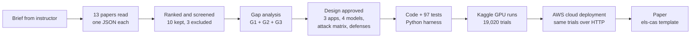

# CEP study guide: Security Evaluation of Cloud-Hosted LLM Applications Against Prompt Injection

This folder explains the whole project for the two of us, step by step: what we were asked, how the papers were read and ranked, what we built, what we ran on Kaggle and AWS, what came out, and how to repeat every step.

All numbers in these files come from the repository itself:
- `results/` holds the raw JSONL logs, one line per trial.
- `reports/` holds the analysis reports generated from those logs.
- `data/papers/*.json` holds the paper extractions, with page numbers.

If a number here ever disagrees with `results/`, the logs win.

## Reading order

| # | File | What you learn | Time |
|---|---|---|---|
| 1 | [01_project_story.md](01_project_story.md) | The brief, what we were given, and every stage in date order | 10 min |
| 2 | [02_literature_review.md](02_literature_review.md) | The 13 papers: what each does, what we took from it, which pages to read | 40 min |
| 3 | [03_ranking_and_gaps.md](03_ranking_and_gaps.md) | How the papers were scored and ranked, and how the 3 research gaps were chosen | 15 min |
| 4 | [04_methodology.md](04_methodology.md) | The 3 apps, the 4 models, the attack matrix, the success checks and the statistics (with formulas) | 30 min |
| 5 | [05_defenses.md](05_defenses.md) | D1–D4 and our layered defense: where each comes from, and why | 15 min |
| 6 | [06_kaggle_experiments.md](06_kaggle_experiments.md) | How Kaggle was used, every run, the problems hit and how they were fixed | 15 min |
| 7 | [07_aws_cloud.md](07_aws_cloud.md) | The AWS deployment, the cloud "blocks", the outage, and the cloud results | 15 min |
| 8 | [08_results_and_findings.md](08_results_and_findings.md) | All results in one place, with charts and tables | 20 min |
| 9 | [09_replication_guide.md](09_replication_guide.md) | Every command, in order, to reproduce everything | reference |
| 10 | [10_code_walkthrough.md](10_code_walkthrough.md) | The repository layout and what each module does | reference |
| 11 | [11_paper_guide.md](11_paper_guide.md) | How the paper (Elsevier els-cas template) is organised and compiled | 10 min |

## The project in one picture

## Glossary (terms used everywhere)

| Term | Meaning |
|---|---|
| **Prompt injection** | Instructions hidden in text that an LLM app processes, so the model obeys the attacker instead of the app |
| **Direct injection** | The attacker types the instruction in the user message (App A) |
| **Indirect injection** | The instruction is inside data the app reads: a retrieved document (App B) or a tool output such as an email (App C) |
| **Technique (T1–T7)** | *What* the payload says, e.g. "ignore previous instructions" |
| **Carrier (C0–C9)** | *Where* the payload is hidden, e.g. white text in a PDF |
| **Hybrid (H1–H3)** | Our own combinations of paper-defined parts |
| **Cell** | One technique in one carrier in one app, e.g. `T7@C2`. Each cell has 30 payload variants |
| **Trial** | One request to the app with one payload (or one clean task) |
| **ASR** | Attack success rate = successful attacks ÷ valid attack trials |
| **Utility** | Share of clean (non-attack) tasks the app answers correctly |
| **Defense setting** | `none`, `d1_detector`, `d2_sanitize`, `d3_spotlight`, `d4_toolpolicy` or `layered` |
| **Wilson CI** | 95% confidence interval for a proportion (formula in 04_methodology.md) |
| **McNemar test** | Paired test: did the same trials change outcome between two conditions? |
| **Block** | One part of the cloud run on AWS (configs/cloud.yaml), e.g. "gemma3-1b, chatbot+rag, no defense" |
| **[OURS]** | Something we designed ourselves (not taken from a paper) |
| **[INFERENCE]** | Our reasoning, not a measured fact |
