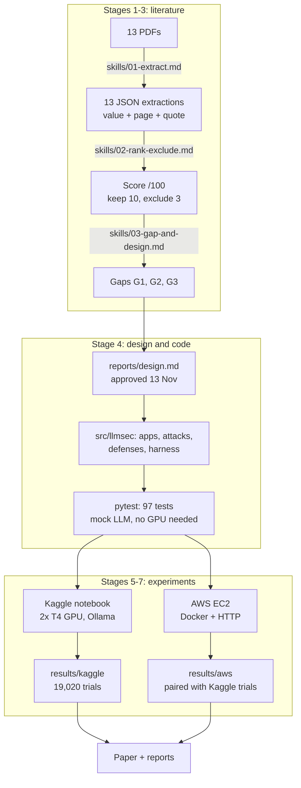

# 1. The project story, from brief to paper

## 1.1 What we were given

The instructor's brief (saved in `CEP_BRIEF.md`) is three sentences:

> Project: "Security Evaluation of Cloud-Hosted LLM Applications Against Prompt Injection".
> Try to attack LLM applications using prompt injection (different types) and study whether each attack succeeded.
> Choose some AI models (preferably open source), design a minimal LLM application for each, try each selected injection type, and report it.

What **we** supplied at the start:
- the 13 papers in `my_papers/` (PDFs, collected 19–31 Oct);
- the decision that the end goal is **cloud-hosted** apps (the title says so). Local or notebook runs are for development, and the final runs go against an app hosted on **AWS** (about **$190 free credit**);
- the requirement that LLM calls be **abstract**, so a model or provider can be switched in one config line;
- the constraints: a laptop with 7.4 GB RAM and no usable GPU, a solo/duo team, and the deadline;
- the working rules (`skills/00-rules.md`): plan before code, one step per commit, every claim traced to a paper page or our own logs, no AI attribution in commits.

## 1.2 Timeline (from `git log`)

| Date | Stage | What happened | Output |
|---|---|---|---|
| 19 Oct | 0. Scaffold | Repository created, first paper search | repo |
| 31 Oct | 1. Extract (part 1) | Papers P01–P08 read; one structured JSON per paper with page-referenced quotes | `data/papers/P01..P08.json` |
| 31 Oct | — | Script that fetches citation counts and GitHub stats automatically | `scripts/fetch_metrics.py`, `data/citations.csv` |
| 7 Nov | 1. Extract (part 2) | All 13 papers extracted | `data/papers/*.json`, `data/ledger.csv` |
| 7 Nov | 2. Rank + exclude | Papers scored out of 100; 10 kept, 3 excluded | `reports/ranking.md` |
| 7 Nov | 3. Gap analysis | Coverage tables; three gaps G1, G2, G3 proposed | `reports/gaps.md` |
| 12 Nov | 3. Decision | Scope locked: G1 + G2 + G3 | `STATE.md` |
| 12–13 Nov | 4. Design + harness | Design approved; 3 apps, attack generator, runner, statistics, Docker; 8 commits (`stage4.0`–`4.8`) | `reports/design.md`, `src/llmsec/` |
| 13 Nov | 4. Pilot | 63-trial timing pilot on Kaggle (free GPU); the laptop was too weak | `reports/pilot_kaggle-pilot.md` |
| 13 Nov | 6. Defenses (code) | D1 detector, D2 sanitize, D3 spotlight, D4 tool policy, layered (`stage6.1`–`6.5`) | `src/llmsec/defenses/` |
| 13 Nov | 5. Baseline session 1 | Kaggle: 3 models × 3 apps, no defense | `results/kaggle/` |
| 14 Nov | 5. Fix + session 2 | `qwen3:4b` turned out to be a "thinking-only" model (68% empty answers), so it was excluded and replaced by `qwen3-4b-instruct`; H1 hybrid added | `results/excluded/`, `reports/baseline_kaggle.md` |
| 14 Nov | 6. Defense runs | Two parallel Kaggle sessions, every defense × every app × 4 models | `reports/defense_kaggle.md` |
| 15 Nov | 7. AWS deploy | EC2 instance on the Free plan; same Docker stack; laptop attacks it over HTTP | `deploy/AWS_GUIDE.md`, `results/aws/` |
| 15 Nov | 8. Paper drafts 1–2 | IEEE draft, then edited with the academic-humanizer skill | `paper/main.tex` |
| 15–16 Nov | 7. Cloud run | Blocks 1–3 done, then an ~18 h network interruption; runner gained `--status` / `--retry-invalid`, then resumed | `results/aws/cloud_run.log` |
| 16 Nov | 7–8. Final | Kaggle-vs-AWS comparison, figures, els-cas paper, these study notes | `reports/cloud_aws.md`, `paper/cas/`, `docs/` |

## 1.3 The stages as a pipeline

## 1.4 Key decisions and why (from the decisions log in `STATE.md`)

| Decision | Why |
|---|---|
| Scope = G1 + G2 + G3 | G1 answers the brief (models × apps × injection types); G2 gives the defense part; G3 matches "cloud-hosted" in the title |
| 3 apps, HTTP API only, no frontend | One app per injection channel the papers study (user input, documents, tool output). A UI adds build time but nothing measurable |
| Small open models (1–4B) through Ollama | Free, local, the same model files on Kaggle and AWS; 3 of them are also in the closest prior work (P05) |
| OpenCode free models **not** used | They only work inside the OpenCode client, add their own agent prompt, and give no control of seed or temperature |
| Free LLM APIs **not** used for the main runs | Rate limits; model versions differ from the Ollama files; no seed control |
| Kaggle instead of the laptop | The laptop has 7.4 GB RAM and no GPU; Kaggle gives free T4 GPUs (12 h sessions) |
| Temperature 0 + fixed seed | The same input gives the same output, so differences come from payloads or deployment, not from random sampling |
| Deterministic success checks, never an LLM judge | P05 p11: weak judge models approve up to 49.7% unsafe outputs |
| 30 variants per cell | Narrower confidence intervals than P10's n=80 total (about ±10 points) |
| D5 self-check not built | Needs a second LLM call; judge quality is unreliable (P05 p11); dropped for time and listed as a limitation |
| `qwen3:4b` replaced by `qwen3-4b-instruct` | The bare tag is a thinking-only model; 691/1,020 answers were empty, so its ASR was falsely near 0 |
| H1 technique = T4 | Rule fixed **before** the run: the best of T1–T6 in visible RAG text (pooled 52% over the first 3 models) |
| AWS `m7i-flex.large` (CPU) | The AWS Free plan forbids GPU instances; this was the only allowed type with 8 GB RAM; it keeps the cost inside the credits |
| Cloud runs = a subset | The CPU server is 10–40× slower than the Kaggle GPU, and the deadline was fixed |
