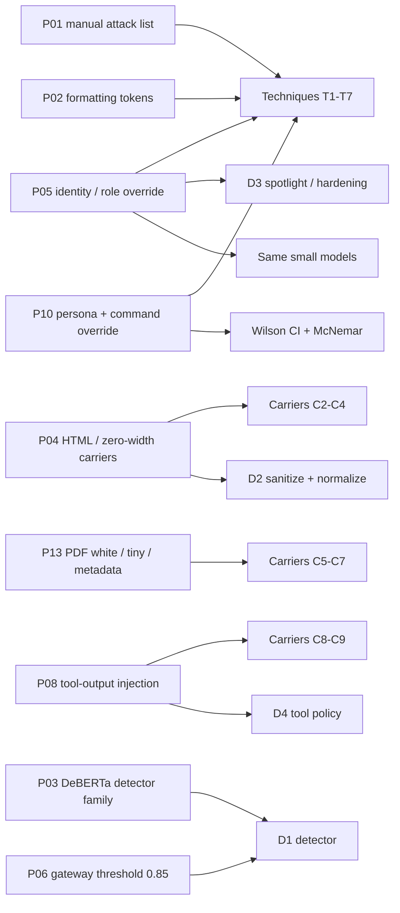

# 2. Literature review: the 13 papers

## 2.1 How the papers were read (Stage 1)

Each PDF was read **once** and turned into a JSON file (`data/papers/Pxx.json`) using the template in `skills/01-extract.md`.
- **Fields:** problem, main idea, threat model, injection types, models, datasets, metrics, results, baselines, limitations, artifacts, and what is reusable for us.
- **Evidence rule:** every fact is stored as `{value, page, quote ≤ 15 words}`. A missing field is written `NOT FOUND`, never guessed. This is why every number below has a page reference: you can open the PDF at that page and find the quote with Ctrl+F.
- **Shared index:** `data/ledger.csv` lists the 13 PDFs (file, DOI, venue, decision), and `paper/facts.md` collects the citable numbers.

## 2.2 Overview

| ID | Short name | Venue | Type | Rank (score/100) | Decision |
|---|---|---|---|---|---|
| P03 | PromptShield | ACM CODASPY 2025 | defense (detector) | 1 (80) | keep, core |
| P08 | CaMeL | IEEE SaTML 2026 | defense (agent design) | 2 (79) | keep, core |
| P04 | OpenRAG-Soc | ACM WWW 2026 | benchmark (RAG carriers) | 3 (74) | keep, core |
| P05 | Small-LLM injection analysis | ACM LM-SHIELD 2026 | attack + defense evaluation | 4 (62) | keep, core |
| P01 | JudgeDeceiver | ACM CCS 2024 | attack (optimization) | 5 (60) | keep, related work |
| P13 | Medical RAG PDF injection | IEEE ICHORA 2026 | attack (indirect, PDF) | 6 (58) | keep, core |
| P06 | Cloud real-time detection | IEEE FLLM 2025 | defense (cloud gateway) | 7 (50) | keep, related work |
| P02 | Neural Exec | ACM AISec 2024 | attack (learned triggers) | 8 (49) | keep, related work |
| P09 | BUUAS edge-cloud detection | IEEE TDSC 2026 | defense (scheduling) | 9 (48) | keep, related work |
| P10 | OceanEnforcer (LLM NPCs) | IEEE ICTIIA 2026 | defense + method | 10 (43) | keep, related work |
| P12 | SPEP cloud agent patterns | IEEE ICAIC 2026 | pattern catalogue | 11 (37) | **excluded** |
| P11 | Privacy-preserving detection | IEEE SmartCloud 2025 | detection / audit | 12 (31) | **excluded** |
| P07 | Edge-cloud latency defense | IEEE SCECS 2026 | system (simulation) | 13 (24) | **excluded** |

**Core** papers shape our design directly; **related-work** papers give context, taxonomy or method. How the scores were computed is in [03_ranking_and_gaps.md](03_ranking_and_gaps.md).

## 2.3 What each paper contributed to our project

## 2.4 Paper cards (read the listed pages)

Format of each card: problem → idea → key numbers (with PDF page) → what we used → limitations → pages to read.

### P01: Optimization-based Prompt Injection Attack to LLM-as-a-Judge (JudgeDeceiver), ACM CCS 2024
- **Problem:** an attacker-crafted answer can hijack an LLM that is used as a judge (p1).
- **Idea:** gradient-based optimization of an injected token sequence. It needs white-box access to an open model (p4).
- **Numbers:** optimized attack ASR 90.8% on Mistral-7B MT-Bench (p3). Manual attacks reach only 7.3–16.3%: naive 7.3, escape characters 12.8, context ignore 7.8, fake completion 7.7, combined 12.8, fake reasoning 16.3 (p8). Known-answer detection misses the attack (FNR 100%, p13).
- **We used:** its **manual-attack taxonomy** became our techniques T1 (naive), T2 (context ignore), T3 (fake completion), T4 (escape characters) and T7 (combined). We dropped fake reasoning because it is close to T3.
- **We did not use:** the optimization attack (it needs a GPU and white-box gradients).
- **Read:** p1, p3–4, **p8 (attack list)**, p13.

### P02: Neural Exec, ACM AISec 2024
- **Problem:** hand-written injection triggers are limited; can triggers be learned (p1)?
- **Idea:** a differentiable search for "execution triggers" that also survive RAG chunking (p1, p9).
- **Numbers:** learned triggers reach about 95% on Llama-3 (p2), mean 91% (p8); 80% persistence through 500-character chunks (p9).
- **We used:** the motivation for **formatting-token / fake-delimiter payloads** (part of T4), and its suggested mitigation of sanitizing special formatting tags (p10).
- **Read:** p1–2, p8–10.

### P03: PromptShield, ACM CODASPY 2025 (rank 1)
- **Problem:** existing injection detectors have too many false positives for real deployment (p1).
- **Idea:** a benchmark plus detectors evaluated at **very low false-positive rates** (p1, p7).
- **Numbers:** at 1% FPR, a fine-tuned Llama-3.1-8B detects 94.80% of injections, DeBERTa-184M 43.22% and PromptGuard 12.78% (p9). Bigger detectors detect better (p9).
- **We used:** the **DeBERTa-v3 detector family** for our D1 (the 8B detector does not fit on CPU). It also explains our finding that D1 misses subtle payloads, given its low TPR at low FPR.
- **Limitation:** its threshold was calibrated on test data (p7). We avoided the same mistake: we never tuned our threshold on our test set.
- **Read:** p1, p7–9.

### P04: Hidden-in-Plain-Text (OpenRAG-Soc), ACM WWW 2026 (rank 3)
- **Problem:** there is no compact web-centric RAG benchmark for HTML, accessibility and Unicode injection carriers (p1).
- **Idea:** an ingest–retrieve–generate harness with carriers (hidden spans, off-screen CSS, alt text, ARIA, zero-width characters) and three defenses: sanitize, Unicode-normalize and attribution-gated answering (p1, p3).
- **Numbers:** macro-average ASR 24.9% (vanilla) → 13.1% (sanitized) → 21.3% (normalized) → 4.7% (all defenses), with 95% CIs (p3). The utility cost is −1.8 / −2.2 points of answerability (p3).
- **We used:** **carriers C2 (hidden span / off-screen CSS), C3 (alt/ARIA) and C4 (zero-width)**, and **defense D2 (sanitize + normalize)**. Our App B follows its RAG setup (BM25 retrieval).
- **Limitation:** the generator model is not named (NOT FOUND); attribution can miss paraphrases (p4).
- **Read:** p1–4 (all of it is relevant).

### P05: Analysis of LLMs Against Prompt Injection and Jailbreak Attacks, ACM LM-SHIELD 2026 (rank 4, closest prior work)
- **Problem:** how vulnerable are small and medium open LLMs, and do cheap defenses help (p1)?
- **Idea:** 10 open models, 91 injection and 74 jailbreak prompts, 5 defenses on 6 models, judged by humans (p3).
- **Numbers:** injection vulnerability qwen3:1.7b 71.3%, gemma3:1b 62.8%, DeepSeek-R1:1.5b 34.0%, Llama3.2:1b 30.9%, and 0% for six larger models (p7). 0% injection vulnerability does not mean jailbreak robustness: Llama3.2:3b is 0% on injection but 69.2% on jailbreaks (p11). Self-Defence is the best defense (1.2%), input filtering the weakest, and system-prompt defenses inconsistent (p10). Weak judges approve up to 49.7% unsafe outputs (p11).
- **We used:**
  - the **same small models** (qwen3:1.7b, gemma3:1b, llama3.2:3b);
  - the attack categories **context reset (T2)**, **identity manipulation (T5)** and **role override (T6)**;
  - the system-prompt defense idea (**D3**);
  - the reason we use **no LLM judge** (p11).
- **Limitation:** direct prompts only; denominators are inconsistent; no confidence intervals. We fixed all three.
- **Read:** p1, p3, **p7–8**, **p10–11**.

### P06: Real-Time Prompt Injection Detection on Cloud-Hosted LLMs, IEEE FLLM 2025
- **Problem:** detect and block injection at the gateway of a cloud-hosted LLM in real time (p1).
- **Idea:** a fine-tuned DistilBERT classifier on AWS SageMaker that blocks prompts scoring above **0.85** and sends telemetry to CloudWatch (p1, p4).
- **Numbers:** DeBERTa-v3 P/R/F1 0.95/0.91/0.93; DistilBERT 0.96/0.92/0.92 (p5); about 220 ms inference (p5).
- **We used:** the **0.85 blocking threshold** for D1 and the idea of a gateway in front of a cloud-hosted model (G3).
- **Limitation:** the repository link was dead (404 on 7 Nov), and the reported DistilBERT F1 does not match its precision and recall.
- **Read:** p1, p4–6.

### P07: Edge-Cloud Collaborative Latency Optimization, IEEE SCECS 2026 (**excluded**, rank 13)
- Simulation only, with no injection types tested; the main results are only in figures, with no numbers (p3–4). One idea (a "restricted mode" for medium-risk requests, p4) was noted but not used.

### P08: Defeating Prompt Injections by Design (CaMeL), IEEE SaTML 2026 (rank 2)
- **Problem:** LLM agents are hijacked through untrusted tool outputs (p1).
- **Idea:** take the control flow **only from the trusted user query**, treat tool outputs as data, and run plans in an interpreter with provenance tags and policies (p1, p4).
- **Numbers:** solves 77% of AgentDojo tasks with security guarantees, against 84% undefended (p1); 2.82× input tokens (p11); utility drops for some models (p16).
- **We used:** **tool-output injection** as a channel (carriers C8 email and C9 web page), and **D4, a simplified CaMeL rule**: the recipients of `send_email` and the paths of `delete_file` must come from the user's own request.
- **Limitation:** closed models only, and a cost overhead.
- **Read:** p1, p4, p7, p11.

### P09: BUUAS, Edge-Cloud Prompt Security Detection, IEEE TDSC 2026
- **Problem:** edge-cloud detection ignores differences between users (p1).
- **Idea:** a Bayesian belief per user plus a contextual bandit that decides which prompts get the edge DeBERTa detector (p1).
- **Used:** confirmation that the **ProtectAI DeBERTa-v3 v2 detector** (our D1) is a standard choice (p8). Related work only; the method needs a GPU and simulation.
- **Read:** p1, p8–10.

### P10: OceanEnforcer, Personality Grounding for LLM NPCs, IEEE ICTIIA 2026
- **Problem:** game NPCs must stay in character under adversarial player input (p1).
- **Numbers:** jailbreak rate on 80 prompts: GPT-4o-mini 28.75 → 26.25% (McNemar p = 0.75); Llama-3.1-8B 26.25 → 18.75% (p = 0.26), so not significant; 0/20 false positives (p4–5).
- **We used:** its **statistical method**: the same prompts run with and without the defense (paired), deterministic failure signals, **Wilson confidence intervals** and the **exact McNemar test** (p4). Also its attack classes **persona-breaking (T5)** and **command override (T6)** (p3). Its n = 80 gives intervals about ±10 points wide, which is why we use 30 variants **per cell**.
- **Read:** p2–5.

### P11: Privacy-Preserving Prompt Injection Detection, IEEE SmartCloud 2025 (**excluded**, rank 12)
- Hash plus MiniLM near-match detection. Its only baselines were variants made by the authors, the results are read from figures, and it was tested on the same template pools it was built from (p5–6). Weak evidence.

### P12: Secure Prompt Engineering Patterns for Cloud LLM Agents (SPEP), IEEE ICAIC 2026 (**excluded**, rank 11)
- A useful threat taxonomy for cloud agents (p2), but the numbers are internally inconsistent: AWS is reported as both 8% and "under 8%", and 78 → 8 is an 89.7% reduction, not the claimed 92% (p5). Cited nowhere as evidence.

### P13: Visual and Structural Prompt Injection in Medical RAG, IEEE ICHORA 2026 (rank 6)
- **Problem:** local medical RAG pipelines parse PDFs and ignore visual attributes, so hidden text can steer the model (p1).
- **Idea:** one fixed payload hidden in PDFs as **white text, 0.1 pt text and metadata**; ASR measured with tracer keywords on six local models (p1, p3, p5).
- **Numbers:** mean ASR 47.78% over 2,400 trials (p1, p5). By vector: white text 50.83, tiny font 49.33, metadata 43.17% (p5). By model: Gemma-3 96.33% down to Meditron 8.67% (p5). Benign documents give 0.00% tracer hits (p5).
- **We used:** **carriers C5 (white text), C6 (0.1 pt) and C7 (metadata)**, and the idea of a **deterministic tracer/marker** success check (our random markers).
- **Limitation:** one payload, one run per document, no CIs, no defense evaluated (sanitization is only future work, p6).
- **Read:** p1, p3–6.

## 2.5 What the literature review says (the story for the paper's Section 2)

1. **Direct-injection techniques** are well catalogued (P01, P05, P10), but they are measured on different models with different success definitions. The numbers are not comparable.
2. **Indirect injection through documents** works through invisible HTML and PDF content (P04, P13). Only P04 evaluates defenses for it, and on an unnamed model.
3. **Tool agents** have one strong design defense (P08), tested only on closed models.
4. **Detectors** are cheap, but small ones miss many attacks at low false-positive rates (P03). Cloud papers (P06, P09) report detector F1, not end-to-end attack success.
5. **Nobody** tests the same small open models across all three channels with one success checker and CIs (G1), measures defenses end-to-end with utility and latency (G2), or compares the same model in a development deployment and a cloud deployment (G3).

## Background references (added 16 Nov, outside the ranked ten)

Taken from our earlier proposal report and checked online (Crossref, arXiv, usenix.org, NeurIPS proceedings, OWASP) before citing. They give context and support specific sentences; they were **not** scored or ranked.

| Key | Reference | Used in the paper for |
|---|---|---|
| greshake2023 | Greshake et al., AISec 2023, pp. 79–90, doi 10.1145/3605764.3623985 | Definition and root cause (instructions and data share one context window); first demonstration of indirect injection on deployed apps |
| liu2024 | Liu et al., USENIX Security 2024, pp. 1831–1847 | Formal benchmark: 5 attacks, 10 defenses, 10 LLMs, 7 tasks |
| yi2025 | Yi et al., KDD 2025, pp. 1809–1820, doi 10.1145/3690624.3709179 | A benchmark for indirect injection (BIPIA) |
| owasp2025 | OWASP Top 10 for LLM Applications 2025, LLM01:2025 Prompt Injection | Prompt injection is risk #1; direct vs indirect definitions |
| echoleak2025 | Reddy and Gujral, AAAI Fall Symposium 2025 (arXiv:2509.10540) | Real cloud case: CVE-2025-32711, one email made Microsoft 365 Copilot leak data, zero-click |
| hines2024 | Hines et al., arXiv:2403.14720 (2024) | Origin of spotlighting (our D3); >50% to <2% on GPT-family models |
| agentdojo2024 | Debenedetti et al., NeurIPS 2024 Datasets and Benchmarks | The benchmark behind CaMeL's 77% task figure |
| nasr2025 | Nasr et al., arXiv:2510.09023 (2025) | Limitation: adaptive attacks bypassed 12 defenses with >90% success for most |

Not carried over from the proposal: the three-cloud plan (we used AWS only, now stated as a limitation), vendor blog posts, the Sysdig "LLMjacking" post (credential theft, not prompt injection), and two 2026 preprints we could not verify.
