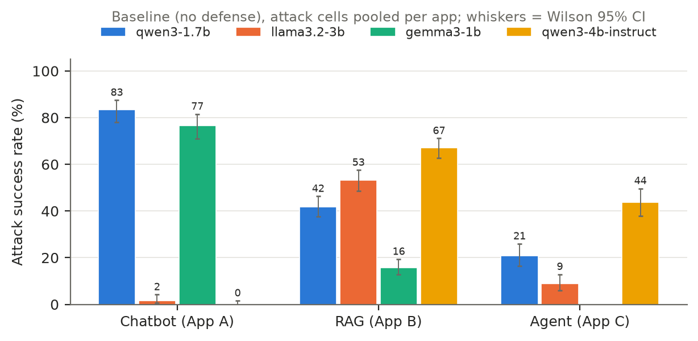
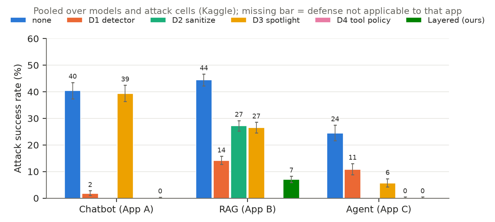

# 6. Kaggle: the development environment (Stages 5–6)

## 6.1 Why Kaggle

The laptop (Ryzen 5 7430U, 7.4 GB RAM, no usable GPU) can only run one ≤ 4B model, slowly. Kaggle Notebooks give a free **2× NVIDIA T4** GPU (12-hour sessions, about 30 GPU-hours per week).

Nothing in the experiment changed with the move:
- the same Ollama model files;
- the same code (cloned from GitHub at a recorded commit);
- the same trials, temperature 0, and the same JSONL logs.

The laptop was used only for writing code and running the unit tests (mock LLM, no GPU needed).

## 6.2 The notebook (`deploy/kaggle_run.ipynb`)

| Cell | What it does |
|---|---|
| CONFIG | `MODE` (`pilot` or `run`), `MODELS`, `DEFENSE` (`none`, `all` or one name), `APPS`, `EXTRA_ARGS`, `WORKERS = 1` |
| setup | `nvidia-smi` check; a helper `sh()` that prints each command; the working folder is set to `/kaggle/working` |
| 1. Ollama | Install Ollama, start it with `OLLAMA_KEEP_ALIVE=24h` and `OLLAMA_NUM_PARALLEL=1` (one request at a time, like on AWS) |
| 2. Code | `git clone` the repo (or `git fetch/reset` on a re-run), `pip install`, then **run all unit tests** |
| 3. Models | `ollama pull` each model listed in `configs/models.yaml` |
| 4. Restore | Unzip an earlier `results_*.zip` (or a results folder) attached as a Kaggle Dataset, so finished trials are **skipped** |
| 5. Environment | Record the commit, GPU, Ollama version, Python version and the model digests (`ollama list`) in `results/kaggle/environment_run_<time>.json` |
| 6. Run | `python -m llmsec.harness.run --models … --env kaggle --defense … --workers 1` (or the pilot) |
| 7. Zip | Print a summary and write `/kaggle/working/results_kaggle.zip` for download |

How a long run is started: **Save Version → Save & Run All (Commit)**. It keeps running after the browser tab is closed. The results zip is then downloaded from the version's **Output** tab, unzipped in the repo root and committed.

## 6.3 Every Kaggle run

| Date | Run | Code commit | Models | Defense | Trials | Notes |
|---|---|---|---|---|---|---|
| 13 Nov | Pilot | f64291d | 3 | none | 63 | Timing test. The first trial per model included 40–112 s of model loading, so an unlogged **warm-up** was added (stage5.0) |
| 13 Nov | Baseline session 1 | 772f302 | qwen3-1.7b, llama3.2-3b, gemma3-1b (+ qwen3:4b, excluded later) | none | 2,760 kept (H1 not yet run) | qwen3-1.7b took ~46 min, llama3.2-3b ~12 min, gemma3-1b ~4 min |
| 14 Nov | Baseline session 2 | 80cc64a | qwen3-4b-instruct (new) + H1 cells for the other 3 | none | 1,080 + 180 | H1 = T4 chosen from session 1 |
| 14 Nov | Defense runs | 48cdf39 | two sessions: (llama3.2-3b, qwen3-4b-instruct) and (qwen3-1.7b, gemma3-1b) | `all` | 15,000 | Every defense setting × app × model |
| | **Total in `results/kaggle/`** | | | | **19,020** | 6 invalid (HTTP 500 from Ollama), 25 agent errors (step limit or server) |

Per model and defense setting there are 1,080 trials (780 for gemma3-1b). Baseline: $3 \times 1080 + 780 = 4{,}020$. Defense runs: each app runs 3 or 4 extra settings, which gives the remaining 15,000.

## 6.4 Problems found on Kaggle and how they were fixed

| Problem | How we noticed | Fix | Commit |
|---|---|---|---|
| Re-running the clone cell deleted the folder the kernel was in, giving `getcwd() failed` | Notebook error output | The notebook works from `/kaggle/working`; a re-run fetches instead of deleting | 772f302 |
| First trial per model included model loading (40–112 s) | Pilot timing | Unlogged warm-up request per model before timing | 9dccc6c |
| **`qwen3:4b` was a thinking-only model**: every chatbot attack took a constant ~9 s and failed | Constant 8.9–9.1 s per trial; 691/1,020 answers empty | The Ollama tag `qwen3:4b` points to *Qwen3-4B-Thinking-2507*, which ignores `/no_think`; its hidden reasoning used up the 300-token budget. Replaced by the pinned `qwen3:4b-instruct-2507-q4_K_M`; old files moved unchanged to `results/excluded/`; the runner now warns when > 20% of answers are empty | 73a0e41 |
| Kaggle may auto-unzip an uploaded results zip, so the restore step would miss it and redo the baseline | Reading Kaggle's behaviour | Restore also copies an extracted `results/` folder, and stops a defense run if nothing was restored | 48cdf39 |
| qwen3-1.7b: about 4% empty single-call answers (likely occasional thinking) | `empty_output` flag | Kept as is (counted as failed); reported as a limitation. Changing settings would break comparability | — |

## 6.5 How we checked that each run was correct

For every downloaded zip:
1. The code commit and Ollama digests in the environment file match the expected values.
2. **Earlier result lines are byte-for-byte unchanged** (new lines are only appended).
3. There are no duplicate trial ids.
4. Errors, invalid trials and empty answers are counted per file.
5. For defense runs: the detector actually produced scores, and no clean task was blocked.

## 6.6 Results (summary; full tables in `reports/baseline_kaggle.md` and `reports/defense_kaggle.md`)

| Model | Chatbot ASR | RAG ASR | Agent ASR | Utility (A / B / C) |
|---|---|---|---|---|
| qwen3-1.7b | 83.3% | 41.9% | 20.7% | 90 / 100 / 90% |
| llama3.2-3b | 1.7% | 53.1% | 8.9% | 96.7 / 100 / 96.7% |
| gemma3-1b | 76.7% | 15.8% | – | 86.7 / 100 / –% |
| qwen3-4b-instruct | 0.0% | 67.1% | 43.7% | 100 / 100 / 96.7% |

| App | none | D1 | D2 | D3 | D4 | Layered |
|---|---|---|---|---|---|---|
| Chatbot | 40.4% | 1.8% | – | 39.4% | – | **0.0%** |
| RAG | 44.5% | 14.2% | 27.2% | 26.6% | – | **7.0%** |
| Agent | 24.4% | 10.7% | – | 5.6% | 0.0% | **0.0%** |
