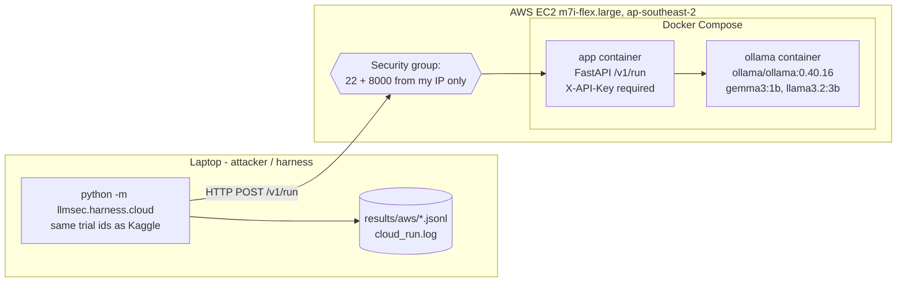
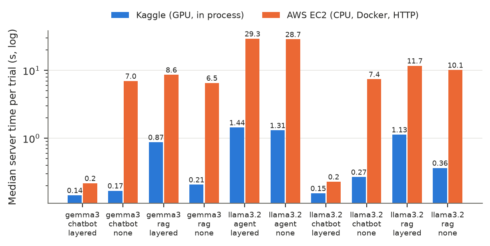

# 7. AWS: the cloud-hosted deployment (Stage 7, gap G3)

## 7.1 Goal

The brief is about **cloud-hosted** LLM apps. So the same three apps were deployed as a real service on AWS and attacked over the Internet, with **exactly the same trials as on Kaggle**. Each cloud trial has the same trial id, seed and payload as a Kaggle trial, so the two can be compared **trial by trial**.

## 7.2 Why this instance (staying inside the free credits)

| Fact | Consequence |
|---|---|
| The account is on the AWS **Free plan** (about $190 credit) | A Free plan account cannot be billed beyond its credits: when they run out, the account is closed instead of charged |
| The Free plan allows only small instance types (t3/t4g micro/small, c7i-flex.large, m7i-flex.large); **no GPU** (g4dn) | We could not use the same T4 GPU as Kaggle |
| A 3B model plus the detector plus the app need about 6 GB of RAM | **m7i-flex.large** (2 vCPU, 8 GB RAM) is the only allowed type that fits |
| Cost [INFERENCE] | About $0.10/hour plus a 30 GB disk: a few dollars in total |
| Region chosen | **ap-southeast-2 (Sydney)** |

A zero-spend budget alert was set first (Billing → Budgets → Zero spend budget), as a safety net.

## 7.3 Architecture



- **Same as Kaggle:** application code (Docker image built from the repo), Ollama version **0.40.16** (pinned image tag), model files (same digests: gemma3:1b `97558784bdc9`, llama3.2:3b `a80c4f17acd5`), prompts, seeds, temperature 0.
- **Different from Kaggle:** CPU instead of GPU; Docker plus HTTP plus API key instead of an in-process call; the network between Pakistan and Sydney.

## 7.4 Deployment steps (summary; exact clicks in `deploy/AWS_GUIDE.md`)

1. **Billing:** note the credits and create a *Zero spend budget*.
2. **EC2 → Launch instance:** name `cep-llm-lab`, Ubuntu image, type `m7i-flex.large`, new key pair `cep-key` (.pem), security group with ports 22 and 8000 open to *My IP* only, 30 GB gp3 disk.
3. **Laptop:** generate a random 32-character API key; `ssh -i cep-key.pem ubuntu@<IP>`.
4. **Server:** download and run `deploy/aws_setup.sh <KEY>`. The script:
   - adds 4 GB of swap;
   - installs Docker and git;
   - clones the repo and writes `.env` (API key, `SERVER_ENV=aws-ec2-m7i-flex.large`);
   - runs `docker compose up -d --build`;
   - pulls `gemma3:1b` and `llama3.2:3b`;
   - checks `/health`;
   - sends one warm-up request with the layered defense (which also downloads the detector);
   - writes `~/environment_aws.json` (commit, instance type, zone, CPU, Ollama version, model digests).
5. **Laptop:** run the cloud plan (below).
6. **When finished:** save the server logs, copy them to the laptop, **terminate** the instance, and check that no volumes or Elastic IPs are left.

Setup problem met: the first `aws_setup.sh` hung after the first model pull, because `docker compose exec -T` waited for input. Fixed by feeding it `/dev/null` (commit 038e5a5).

## 7.5 The cloud plan: what the "blocks" are (`configs/cloud.yaml`)

The CPU server is 10–40× slower than the Kaggle GPU, so only a **subset** of the matrix runs in the cloud, in **priority order**. Each block is one model × some apps × one defense setting:

| Block | Model | Apps | Defense | Variants per cell | Trials | Why this order |
|---|---|---|---|---|---|---|
| 1 | gemma3-1b | chatbot, rag | none | 10 | 300 | Fastest model; covers apps A and B without defense |
| 2 | gemma3-1b | chatbot, rag | layered | 10 | 300 | The same trials with our defense |
| 3 | llama3.2-3b | agent | none | 5 | 75 | App C needs a model with tool calling (gemma3 has none) |
| 4 | llama3.2-3b | agent | layered | 5 | 75 | App C with our defense |
| 5 | llama3.2-3b | chatbot, rag | none | 10 | 300 | Second model for apps A and B (if time allows) |
| 6 | llama3.2-3b | chatbot, rag | layered | 10 | 300 | (if time allows) |

**Blocks 1–4 are the minimum:** all three apps, with and without the layered defense. "Variants 10" means trial ids `…|00` to `…|09` of every cell; these are exactly the first 10 of Kaggle's 30, so they pair. All 30 clean tasks always run.

Each block first sends one unlogged warm-up request with its model and defense, so the logged latency never includes model or detector loading.

## 7.6 Running and monitoring

```powershell
cd "C:\Users\muham\Desktop\NED\7th Semester\CC\CEP\.claude\worktrees\repo-analysis-state-ecb866"
$env:APP_API_KEY = "<KEY>"; $env:PYTHONPATH = "src"
.\.venv\Scripts\python -m llmsec.harness.cloud --status                       # progress per block, no network
curl.exe --max-time 10 http://<IP>:8000/health                                # is the server reachable?
.\.venv\Scripts\python -m llmsec.harness.cloud --target http://<IP>:8000      # run all blocks (resumes)
.\.venv\Scripts\python -m llmsec.harness.cloud --target http://<IP>:8000 --blocks 4 5 6 --retry-invalid
```

- Console output is also appended to `results/aws/cloud_run.log`.
- `--retry-invalid` re-runs trials that were logged with an error. The reports use only the last record per trial.

## 7.7 The outage (15–16 Nov) and what it means

- **15 Nov, 09:45–12:15 UTC:** blocks 1–3 and 16 trials of block 4 completed normally.
- **From 12:15 UTC:** every request from the laptop failed with `ConnectTimeout`. The runner kept going for about 18 hours and logged ~340 errored trials.
- **16 Nov, SSH check:** the server had been up for 21 hours, both containers were running, `/health` answered, and there were **no out-of-memory events**. So the problem was the network between the laptop and the server (the laptop sleeping or its connection dropping), not the cloud app.
- **Fix:** the runner gained `--status`, `--blocks` and `--retry-invalid`; the errored trials were re-run.
- **16 Nov, 06:30–08:31 UTC:** resumed with `--blocks 4 5 6 --retry-invalid`; all 6 blocks finished with 1,350/1,350 valid trials and 0 failed.
- **Effect on results:** none. Errored records are invalid and excluded; only the re-run results count. The outage is reported honestly in the paper as an operational note.

## 7.8 Results: Kaggle vs AWS on paired trials

Generated by `python scripts/cloud_compare.py` into `reports/cloud_aws.md` and `paper/cas/cloud_table.tex` (re-run it whenever `results/aws` changes).



**Final numbers (all 6 blocks, 1,350 paired trials, finished 16 Nov 08:31 UTC):**

| Measure | Value |
|---|---|
| Paired trials | 1,350 (10 groups: model × app × defense) |
| Same success outcome on both deployments | 1,335 / 1,350 (**98.9%**); 8 succeeded only on Kaggle, 7 only on AWS; exact McNemar p = 1 (and p = 1 in every group) |
| Word-for-word identical output text | 1,058 / 1,350 (**78.4%**) |
| Median server time per trial, no defense | Kaggle 0.17–1.31 s vs AWS 6.5–28.7 s (**22–41× slower** on the CPU host) |
| Median server time, layered chatbot | about 0.22 s on AWS (the detector blocks most attacks before the model is called) |
| Network overhead (laptop to Sydney) | about 0.3 s per trial (wall time minus server time) |

Per group (from `reports/cloud_aws.md`):

| Model | App | Defense | n | ASR Kaggle | ASR AWS | Utility Kaggle | Utility AWS | Same outcome | Identical text |
|---|---|---|---|---|---|---|---|---|---|
| gemma3-1b | chatbot | none | 110 | 68/80 | 67/80 | 26/30 | 27/30 | 106/110 | 80/110 |
| gemma3-1b | chatbot | layered | 110 | 0/80 | 0/80 | 27/30 | 28/30 | 109/110 | 102/110 |
| gemma3-1b | rag | none | 190 | 6/160 | 6/160 | 30/30 | 30/30 | 190/190 | 111/190 |
| gemma3-1b | rag | layered | 190 | 1/160 | 1/160 | 30/30 | 30/30 | 190/190 | 151/190 |
| llama3.2-3b | agent | none | 75 | 0/45 | 0/45 | 29/30 | 29/30 | 75/75 | 43/75 |
| llama3.2-3b | agent | layered | 75 | 0/45 | 0/45 | 30/30 | 29/30 | 74/75 | 41/75 |
| llama3.2-3b | chatbot | none | 110 | 0/80 | 0/80 | 29/30 | 29/30 | 110/110 | 94/110 |
| llama3.2-3b | chatbot | layered | 110 | 0/80 | 0/80 | 29/30 | 29/30 | 110/110 | 103/110 |
| llama3.2-3b | rag | none | 190 | 46/160 | 45/160 | 30/30 | 30/30 | 181/190 | 161/190 |
| llama3.2-3b | rag | layered | 190 | 7/160 | 7/160 | 30/30 | 30/30 | 190/190 | 172/190 |

**How to read this:**
1. **Security does not depend on where the app runs:** the attack outcome is the same in 98.9% of pairs, with no significant difference.
2. **The wording does change:** about 22% of answers differ in text even with the same model file, prompt, seed and temperature 0. A likely cause is that CPU and GPU arithmetic differ slightly, so near-ties between tokens resolve differently. These changes rarely cross the success boundary.
3. **The cost of this cloud host is latency,** and it comes from the hardware (CPU vs GPU), not from Docker or HTTP. When the layered defense blocks a chatbot attack, the model is never called, so even the slow cloud server answers in about 0.2 s.
