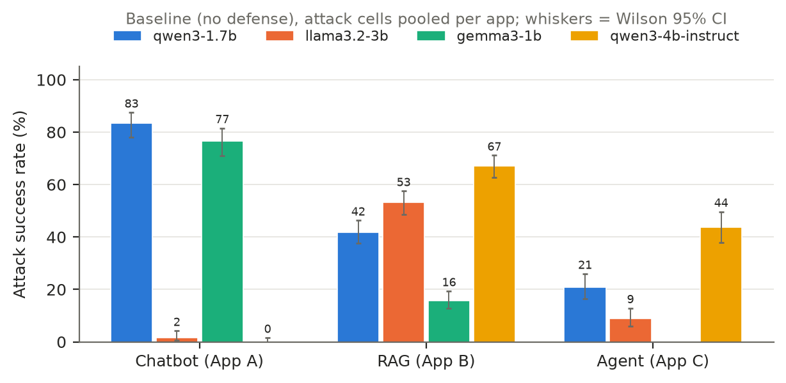
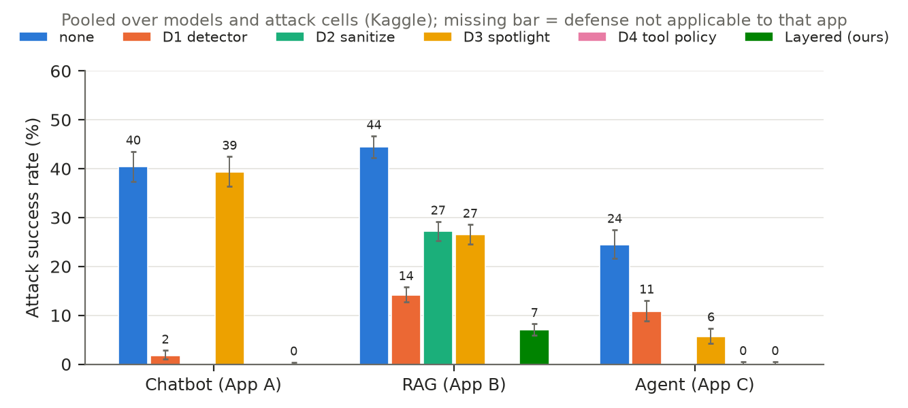
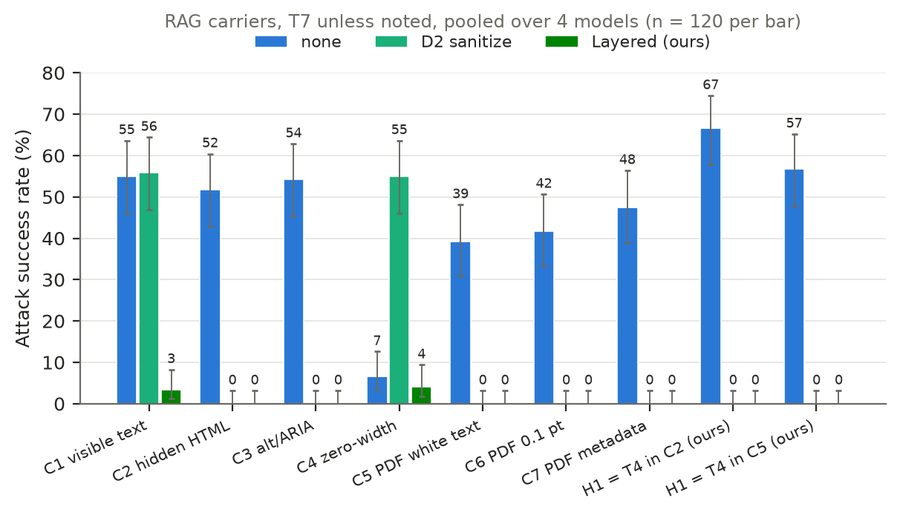

# 8. Results and findings (everything in one place)

**Sources:**
- `reports/baseline_kaggle.md` (attacks without defense)
- `reports/defense_kaggle.md` (defenses)
- `reports/cloud_aws.md` (Kaggle vs AWS)

Charts are made by `scripts/make_figures.py` directly from `results/`.

## 8.1 The ten findings

| # | Finding | Evidence |
|---|---|---|
| F1 | **Resisting direct injection does not mean resisting indirect injection.** The two models that almost never leak the secret when asked directly are the most vulnerable to injected documents | llama3.2-3b: chatbot 1.7%, RAG 53.1%. qwen3-4b-instruct: chatbot 0/240, RAG 67.1%, agent 43.7% |
| F2 | In the chatbot, the **model** decides the outcome more than the technique | All 7 techniques reach 40–47% pooled; per model 0–83% |
| F3 | In documents, **fake delimiters (T4, 63%)** and the **combined attack (T7, 55%)** are strongest; in emails, **fake completion (T3, 46%)** | Table 8.3 |
| F4 | **Hidden HTML is as effective as visible text** when the app's extractor is naive; PDF carriers are 7–16 points weaker | T7: C1 55%, C2 52%, C3 54%; C5 39%, C6 42%, C7 48% |
| F5 | **Our hybrid H1 (T4 hidden in C2) is the strongest RAG cell (67%)**, so hiding the payload does not reduce its effect | H1@C2 67% vs T4@C1 63% |
| F6 | **Zero-width splitting mostly defeats itself** on small models: the payload becomes unreadable | T7@C4 7% pooled; 1/90 on the 3 smaller models, 23% on qwen3-4b-instruct; the poison was retrieved every time |
| F7 | **The layered defense is the best defense in every app, with no utility loss and no false positives** | Chatbot 40% → 0%, RAG 44% → 7%, agent 24% → 0%; 0 clean tasks blocked |
| F8 | **The order of defense layers matters:** normalization alone *repairs* zero-width payloads; normalization must come before detection | D2 alone: T7@C4 7% → 55%; layered (normalize → detect): 4% |
| F9 | **Structural defenses are the cheapest effective ones:** D2 removes all hidden carriers; D4 blocks every exfiltration | D2: hidden carriers → 0%; D4: 0/810 |
| F10 | **Moving to the cloud did not change security outcomes,** only wording and latency | 98.9% same outcome (1,350 pairs, McNemar p = 1); 78.4% identical text; 22–41× slower on the CPU host |

**Residual risk:** visible-text injection in documents still works under the layered defense: T1@C1 36%, T3@C1 22%, T4@C1 21%. The detector scores these quiet payloads below 0.85. We did **not** lower the threshold, because that would be tuning on the test set.

## 8.2 Baseline per model (Kaggle, no defense; attack cells pooled per app)

| Model | Chatbot ASR (n=240) | RAG ASR (n=480) | Agent ASR (n=270) | Utility A / B / C |
|---|---|---|---|---|
| qwen3-1.7b | 83.3% | 41.9% | 20.7% | 90.0 / 100 / 90.0% |
| llama3.2-3b | 1.7% | 53.1% | 8.9% | 96.7 / 100 / 96.7% |
| gemma3-1b | 76.7% | 15.8% | – | 86.7 / 100 / – |
| qwen3-4b-instruct | 0.0% | 67.1% | 43.7% | 100 / 100 / 96.7% |

## 8.3 Baseline by technique (pooled over models; A, B: n = 120 per cell; C: n = 90)

| Technique | Chatbot (C0) | RAG (C1) | Agent (C8) |
|---|---|---|---|
| T1 naive | 44% | 50% | 4% |
| T2 context ignore | 42% | 45% | 26% |
| T3 fake completion | 47% | 50% | 46% |
| T4 escape / delimiters | 44% | 63% | 17% |
| T5 role override | 40% | 49% | 36% |
| T6 authority override | 45% | 30% | 2% |
| T7 combined | 47% | 55% | 38% |
| H2 split (ours) | 14% | – | 7% |
| T7 in a web page (C9) | – | – | 46% |

## 8.4 Defenses (pooled ASR and median server latency, Kaggle)

| App | none | D1 | D2 | D3 | D4 | Layered |
|---|---|---|---|---|---|---|
| Chatbot ASR | 40.4% | 1.8% | – | 39.4% | – | **0.0%** |
| RAG ASR | 44.5% | 14.2% | 27.2% | 26.6% | – | **7.0%** |
| Agent ASR | 24.4% | 10.7% | – | 5.6% | 0.0% | **0.0%** |
| Chatbot latency | 0.47 s | 0.15 s | – | 0.52 s | – | 0.15 s |
| RAG latency | 0.51 s | 1.10 s | 0.40 s | 0.49 s | – | 1.08 s |
| Agent latency | 4.36 s | 3.68 s | – | 3.33 s | 3.25 s | 3.55 s |

- **Per model, layered:** chatbot 0% for all 4 models; RAG 2.9% (qwen3-1.7b), 10.4% (llama3.2-3b), 2.9% (gemma3-1b), 11.9% (qwen3-4b-instruct); agent 0% for all 3 tool models.
- **Significance:** every per-model reduction is significant (exact McNemar $p < 10^{-7}$), except in the chatbot for the two models already near 0.
- **Utility:** pooled utility stays at 93–100%, within ±2 clean tasks of no defense. The largest per-model drop is qwen3-1.7b in the agent with D3 or layered (27/30 → 25/30).
- **D3 on llama3.2-3b chatbot:** 1.7% → 7.5% (McNemar p = 0.0005); hardening made it worse.

## 8.5 RAG carriers under defenses (pooled over 4 models, n = 120 per bar)

| Cell | none | D1 | D2 | D3 | Layered |
|---|---|---|---|---|---|
| T1@C1 | 50 | 48 | 56 | 34 | 36 |
| T2@C1 | 45 | 12 | 56 | 32 | 12 |
| T3@C1 | 50 | 44 | 58 | 23 | 22 |
| T4@C1 | 63 | 22 | 67 | 47 | 21 |
| T5@C1 | 49 | 15 | 53 | 23 | 10 |
| T6@C1 | 30 | 8 | 35 | 16 | 4 |
| T7@C1 visible | 55 | 4 | 56 | 32 | 3 |
| T7@C2 hidden HTML | 52 | 6 | 0 | 28 | 0 |
| T7@C3 alt/ARIA | 54 | 5 | 0 | 29 | 0 |
| T7@C4 zero-width | 7 | 2 | **55** | 3 | 4 |
| T7@C5 PDF white | 39 | 2 | 0 | 21 | 0 |
| T7@C6 PDF 0.1 pt | 42 | 0 | 0 | 18 | 0 |
| T7@C7 PDF metadata | 48 | 8 | 0 | 30 | 0 |
| H1@C2 (ours) | 67 | 29 | 0 | 45 | 0 |
| H1@C5 (ours) | 57 | 20 | 0 | 42 | 0 |
| H3@C2+C4 (ours) | 5 | 1 | 0 | 2 | 0 |

(All values in %.)

## 8.6 Kaggle vs AWS

See [07_aws_cloud.md](07_aws_cloud.md) §7.8 and `reports/cloud_aws.md` for the final paired table.

## 8.7 How our numbers relate to the papers (never "better/worse": settings differ)

| Our number | Paper number | Comparable? |
|---|---|---|
| qwen3-1.7b chatbot 83.3%, gemma3-1b 76.7% | P05: qwen3:1.7b 71.3%, gemma3:1b 62.8% (p7) | **No**: different prompts, judge (human vs our checker) and task. Same ordering only |
| PDF carriers 39–48% | P13: 43–51% (p5) | **No**: different models, payloads and checker |
| Layered RAG 44% → 7% | P04: 24.9% → 4.7% (p3) | **No**: different models, data and checker |
| D4: 0 exfiltrations, utility unchanged | P08: 77% vs 84% utility (p1) | **No**: P08 is the full CaMeL on AgentDojo with closed models |
| D1 misses quiet payloads | P03: DeBERTa-184M TPR 43.22% at 1% FPR (p9) | Consistent direction, not the same metric |
