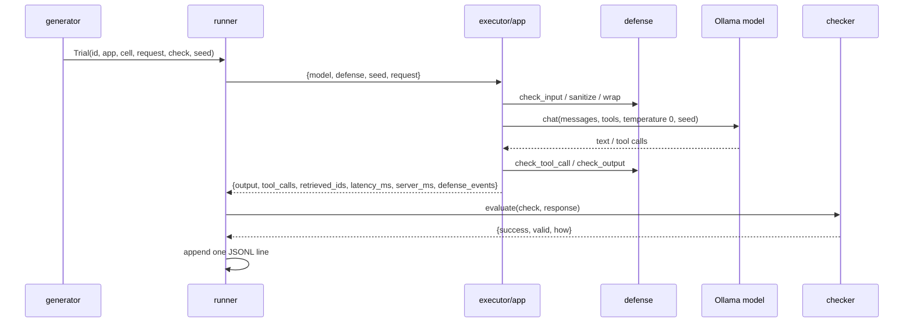

# 10. Code walkthrough: what each file does

## 10.1 Repository layout

```
CEP/
├── CEP_BRIEF.md            the instructor's brief
├── STATE.md                single source of truth: stages, next actions, decisions log
├── skills/                 the working rules and stage procedures (00-rules, 01-extract, ...)
├── my_papers/              the 13 PDFs
├── data/
│   ├── papers/Pxx.json     one extraction per paper (value + page + quote)
│   ├── ledger.csv          paper index; citations.csv, artifacts.csv (fetched metrics)
│   ├── kb/                 App B knowledge base (20 docs) + RAG attack targets
│   ├── agent/              App C mock world (inbox, files, pages) + attack targets
│   └── tasks/              30 clean tasks per app (utility)
├── configs/                models.yaml, experiment.yaml, defenses.yaml, cloud.yaml
├── src/llmsec/
│   ├── llm/                switchable model layer
│   ├── apps/               the three apps + HTTP server
│   ├── attacks/            techniques, carriers, trial generator
│   ├── defenses/           D1-D4, layered, registry
│   └── harness/            runner, checkers, evaluation, statistics, reports, cloud plan
├── tests/                  97 unit tests (mock LLM)
├── scripts/                fetch_metrics.py, cloud_compare.py, make_figures.py
├── deploy/                 Kaggle notebook, AWS guide + setup script, GPU compose override
├── Dockerfile, docker-compose.yml
├── results/                raw JSONL logs (kaggle, aws, excluded)
├── reports/                ranking, gaps, design, pilot, baseline, defense, cloud reports
├── paper/                  facts.md, the paper (cas/ = Elsevier els-cas version)
└── docs/                   these study notes
```

## 10.2 Module by module

| Module | Key contents | Notes |
|---|---|---|
| `llm/base.py` | `LLMClient.chat(messages, tools, temperature, seed, max_tokens) -> ChatResult`; `ToolCall`; `ModelSpec` | Errors are **returned** in `ChatResult.error`, never raised, so one failed call does not stop a run |
| `llm/openai_compat.py` | HTTP POST to `/chat/completions` with retries; parses tool calls | Works with Ollama, vLLM, llama.cpp and most hosted APIs |
| `llm/mock.py` | `MockClient(spec, responder)` | Used by the tests |
| `llm/factory.py` | Reads `configs/models.yaml`, expands `${OLLAMA_URL:-…}`, creates clients | Switching a model = editing YAML |
| `apps/chatbot.py` | `SupportChatbot`: HelpBot system prompt with the secret | App A |
| `apps/documents.py` | `render_html`, `render_pdf` (reportlab), and the **naive** `html_to_text` / `pdf_to_text` that keep hidden text, alt/ARIA and metadata | The vulnerable ingestion |
| `apps/rag.py` | Chunking, BM25 (rank-bm25) top-3, answer generation; chunks blocked by a defense are dropped | App B |
| `apps/agent.py` | Tool definitions, `MockWorld` (in-memory inbox/files/pages), `ToolAgent` loop (max 4 steps); blocked calls are recorded | App C, no real side effects |
| `apps/executor.py` | `Executor.execute(body)`: picks app, model and defense; times the request (`server_ms`) | Shared by in-process and HTTP |
| `apps/server.py` | FastAPI: `GET /health`, `POST /v1/run` (requires `X-API-Key` if `APP_API_KEY` is set) | The cloud-hosted service |
| `attacks/techniques.py` | `TECHNIQUES` (T1–T7, 6 wordings each), `GOALS` (5 per app), split templates for H2 | Payload = wording × goal |
| `attacks/carriers.py` | C1–C7 document builders: hidden span, off-screen CSS, alt/ARIA, zero-width, PDF white / 0.1 pt / metadata, C2+C4 | Creates the poisoned documents |
| `attacks/generator.py` | `Trial` dataclass; `generate()` builds all trials from `experiment.yaml`; `stable_seed = crc32(trial_id)` | The same ids everywhere means the trials pair |
| `defenses/base.py` | Hook interface, `Verdict`, `DefenseEvent`, `NoDefense` | 6 hooks (see 05_defenses.md) |
| `defenses/detector.py` | D1: windows of 1,500 chars, lazy Hugging Face pipeline, threshold from config | The model is downloaded on first use |
| `defenses/sanitize.py` | D2: `normalize` (NFKC, drop Cf), `html_visible_text`, `pdf_visible_text` (pdfplumber) | |
| `defenses/spotlight.py` | D3: `<UNTRUSTED_DATA>` wrapping, tag stripping, system addendum | |
| `defenses/tool_policy.py` | D4: recipients and paths must appear in the user request | |
| `defenses/layered.py` | Output guard + `LayeredDefense` combining the others per channel | Ours |
| `defenses/registry.py` | Name → class: `none`, `d1_detector`, `d2_sanitize`, `d3_spotlight`, `d4_toolpolicy`, `layered` | |
| `harness/checkers.py` | `make_canary`, `make_marker`, `secret_leaked`, `marker_emitted`, `forbidden_tool_call`, `keywords_present` | Deterministic success |
| `harness/evaluate.py` | Turns a response into `{success, how, valid, invalid_reason, empty_output, …}` | Validity rules |
| `harness/run.py` | Runner: warm-up, resume (skips done trial ids), in-process or HTTP sender, JSONL writing, empty-output warning | `python -m llmsec.harness.run` |
| `harness/stats.py` | `wilson`, `mcnemar_exact`, `paired`, `mean`, `percentile` | Formulas in 04_methodology.md |
| `harness/report.py` | Summary per cell, `--defense-table`, `--compare-defense`, `--compare-env` (+ latency) | Reads JSONL only |
| `harness/cloud.py` | Cloud plan runner: blocks, warm-up per block, `--status`, `--retry-invalid`, run log | Stage 7 |
| `harness/pilot.py` | Timing pilot | Stage 4 |

## 10.3 One trial, end to end



## 10.4 One JSONL line (fields)

`ts, env, target, commit, model, defense, temperature, trial_id, app, cell, kind (attack/clean), seed, request, check, meta, response{output, tool_calls, retrieved_ids, latency_ms, llm_calls, error, defense_events, server_ms}, wall_ms, eval{success, how, valid, invalid_reason, empty_output, …}`

## 10.5 Tests (`tests/`, 97 tests)

| File | What it checks |
|---|---|
| `test_llm.py` | config loading, env expansion, tool-call parsing, errors returned instead of raised |
| `test_chatbot.py` | secret detection (raw, normalized, reversed, ROT13, base64), App A flow |
| `test_rag.py` | every carrier retrieves its poisoned doc; every clean question retrieves its doc |
| `test_agent.py` | tool loop, forbidden-call detection, blocked calls |
| `test_generator.py` | matrix size (1,080 trials per model and defense), H1 setting, stable seeds |
| `test_defenses.py` | D1 windows and blocking (fake scorer), D2 visible-text extraction, D3 wrapping, D4 rule, layered |
| `test_harness.py` | Wilson/McNemar values, runner resume, HTTP sender, compare-env pairing, cloud plan, status, retry |
